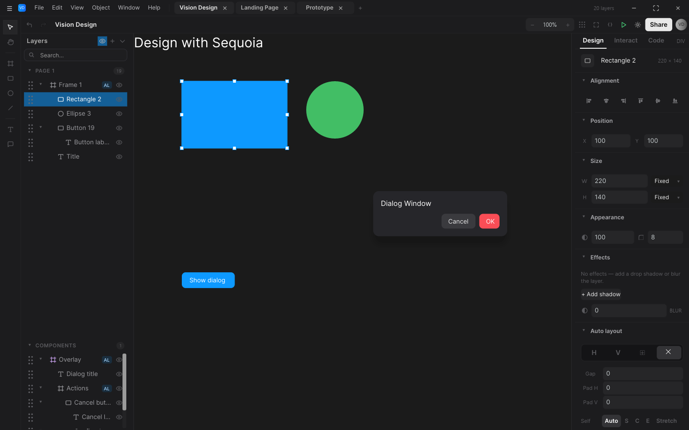

# Sequoia

A native, reactive GUI framework for Rust built on `wgpu`. Sequoia keeps a
retained view tree and updates it with fine-grained signals. There is no
Virtual DOM, no WebView, and no JavaScript runtime.

**[Documentation](https://nurt-studio.github.io/Sequoia-UI/)** ·
[API reference](https://docs.rs/sequoia-ui) ·
[crates.io](https://crates.io/crates/sequoia-ui)

<p align="center">
  
</p>

*Vision Design is a complete design-tool example in this repository. It uses
the same public API that ships in `sequoia-ui`. The screenshot above is
rendered headlessly by `cargo run -p vision-design --bin render`, so it always
matches the code in `example/vision-design`.*

## What you get

- **Native rendering.** Views paint through `wgpu` on Metal, Vulkan, DX12, or
  OpenGL. Your UI does not run inside a browser engine.
- **Fine-grained reactivity.** Signals update only the views that read them.
  There is no diff step and no Virtual DOM.
- **Rust-first widgets.** Rows, columns, grids, docks, forms, tables, tabs,
  overlays, scrolling, text inputs, and more.
- **Experimental `.seq` loader.** An optional declarative format is available
  through `SeqLoader`; the Rust API remains the supported path.
- **GPU effects.** Typed shaders, offscreen targets, blur, masks, and reusable
  effect chains.
- **Desktop details.** IME, accessibility metadata, hotkeys, animations, async
  work, multi-window support, and headless PNG export.

## Performance

A short version: in a list of **3 000 rows**, changing one row updates one row
and costs about **0.01 ms** of reactive work. Changing every row at once still
fits comfortably in a single 60 fps frame, on integrated graphics.

The benchmark (`crates/sequoia-ui/examples/row_update.rs`) builds the list once,
then changes row data for 110 frames. The first 10 frames are warm-up; the rest
are reported as the median (p50), which is the typical frame, not the best one.

Two terms used below:

- **Rebuilt** — the row's text closure runs again to produce a new string.
  Nothing else in the tree is touched.
- **Coarse trigger** — a global version signal that every row reads, so changing
  it marks the whole list dirty. It is the worst case for any reactive UI, for
example a shared "document changed" counter.

### Without a window (CPU only)

| What changes each frame | Rows rebuilt | Rebuild p50 | Frame p50 | Layout: measure | Layout: arrange |
| --- | ---: | ---: | ---: | ---: | ---: |
| One row (fine-grained) | 1 | 0.01 ms | 1.11 ms | 0.07 ms | 0.34 ms |
| One row, but the whole list is marked dirty | 38 | 0.25 ms | 0.80 ms | 0.10 ms | 0.18 ms |
| All 3 000 rows (fine-grained) | 38 | 0.66 ms | 1.27 ms | 0.11 ms | 0.19 ms |

Even when the list is marked dirty as a whole, only the rows that are on screen
are rebuilt. Text measurement is cached between frames and shows the same effect:
changing one row keeps **149 of 153** measurements, while dirtying everything
leaves only **38**.

### With a window — Intel HD Graphics 620, wgpu/Vulkan, 800×600, vsync on

| What changes each frame | Rebuild p50 | Frame p50 | Average frame |
| --- | ---: | ---: | ---: |
| One row (fine-grained) | 0.02 ms | 2.50 ms | 10.24 ms |
| One row, but the whole list is marked dirty | 1.22 ms | 12.63 ms | 14.51 ms |
| All 3 000 rows (fine-grained) | 2.04 ms | 15.61 ms | 14.01 ms |

The entire list is painted with **3 render passes and 2 draw calls**, about 600
glyphs per frame. Vsync holds the average frame time at the display refresh rate,
so the last column means "the frame was ready and waited for the screen", not
"the frame cost 14 ms". Add `--no-vsync` to see the raw cost.

These numbers come from one modest laptop GPU, not from every machine. To
reproduce them:

```text
cargo run --release --example row_update              # all CPU scenarios
cargo run --release --example row_update -- gpu s1    # one row, fine-grained
cargo run --release --example row_update -- gpu s2    # one row, whole list dirty
cargo run --release --example row_update -- gpu s3    # all rows
```

## Install

```toml
[dependencies]
sequoia-ui = "0.1.5"
```

`sequoia-ui` is the single facade crate. It re-exports the whole framework:
platform, views, widgets, layout, styling, rendering, animation, and async.
You do not need to clone this repository or add the internal crates by hand.

Requires Rust 1.88 or newer.

## Quick start

```rust
use sequoia_ui::prelude::*;

fn main() {
    let count = Signal::new(0i32);
    let display = count.clone();

    App::new()
        .title("Counter")
        .size(480.0, 320.0)
        .root(
            Column::new()
                .gap(12.0)
                .padding(24.0)
                .child(Text::with(move || format!("Count: {}", display.get())))
                .child(
                    Button::new("Increment")
                        .on_click(move || count.update(|n| *n += 1)),
                ),
        )
        .run()
        .expect("failed to run the app");
}
```

The signal is the state. Any view that reads it rebuilds automatically when
the value changes. There is no separate store to synchronize.

## Experimental `.seq` support

The repository also contains an experimental declarative `.seq` format,
available through `SeqLoader`. It is optional and still evolving; the Rust API
is the supported path for production applications. The `seq_hello` example in
`crates/sequoia-ui/examples` shows the current loader API.

## Layout and widgets

`Row`, `Column`, and `Wrap` handle linear flow. `Grid` places children in
fixed tracks, `Stack` layers content, `SplitPanel` divides resizable panes, and
`DockArea` manages IDE-style panels.

```rust
let toolbar = Row::new()
    .gap(8.0)
    .padding(12.0)
    .child(Button::new("Open"))
    .child(Spacer::flex(1.0))
    .child(Text::new("Ready"));

let sidebar = Column::new()
    .width(220.0)
    .gap(8.0)
    .padding(16.0)
    .child(Text::new("Layers").bold())
    .child(Text::new("Background"))
    .child(Text::new("Card"));

let body = Row::new()
    .fill_size()
    .child(sidebar)
    .child(Container::new().fill_size().padding(16.0).child(Text::new("Canvas")));

let page = Column::new().fill_size().child(toolbar).child(body);
```

The widget set includes buttons, text fields, text areas, checkboxes, switches,
sliders, dropdowns, color pickers, progress bars, tabs, tables, tree views,
virtual lists, tooltips, toasts, dialogs, command palettes, and more.

## GPU effects

Custom shaders are written with the `shader!` macro and validated at compile
time. Register the generated type on the app, then draw it through a `Canvas`:

```rust
use sequoia_ui::prelude::*;
use sequoia_ui::shader::shader;

shader! {
    pub fn procedural_grid(
        uv: FragUv,
        cell: f32,
        line: Color,
        background: Color,
    ) -> Color {
        let position = uv * cell;
        let edge = abs(fract(position) - vec2<f32>(0.5, 0.5));
        let on_line = step(0.45, max(edge.x, edge.y));
        return mix(background, line, on_line);
    }
}

let view = Canvas::new().with_shader_pass(ShaderPass::new(ProceduralGrid {
    cell: 16.0,
    line: sequoia_ui::shader::Color::rgba(0.16, 0.18, 0.22, 1.0),
    background: sequoia_ui::shader::Color::rgba(0.10, 0.11, 0.13, 1.0),
}));

App::new()
    .shader_type::<ProceduralGrid>()
    .root(view)
    .run()
    .expect("event loop failed");
```

`ShaderPass` carries the rectangle, blend mode, UV window, and named texture
inputs. `ShaderChain` sequences passes through offscreen targets. `ShaderRegistry`
collects sources and removes duplicate names. A pass that is not registered is
skipped, so an optional effect does not blank the layer.

## How it fits together

| Crate | Role |
| --- | --- |
| `sequoia-ui` | Facade crate and prelude |
| `sequoia-core` | Geometry, colors, render list, render targets |
| `sequoia-reactive` | Signals, effects, stores, undo |
| `sequoia-view` | Retained view tree, runtime, layouts, overlays |
| `sequoia-elements` | Text inputs, buttons, tables, and other widgets |
| `sequoia-layout` | Flexbox-style layout engine |
| `sequoia-text` | Shaping, glyph atlas, rich text |
| `sequoia-render` | `wgpu` renderer, passes, filters, image atlas |
| `sequoia-platform` | `winit` application loop, windows, IME, hotkeys |
| `sequoia-style` | Themes, visual states, shadows, gradients |
| `sequoia-shader` | Typed shader macro, math library, registry |
| `sequoia-seq` | Parser and loader for `.seq` files |
| `sequoia-export` | Headless HiDPI PNG export |
| `sequoia-assets` | SVGs, icons, photos, fonts |

## Examples

The repository contains runnable examples that need no extra setup. Run them
from the workspace root.

```text
cargo run -p vision-design
cargo run -p paint
cargo run -p sequoia-ui --example showcase
cargo run -p sequoia-ui --example form
cargo run -p sequoia-ui --example todo
cargo run -p sequoia-ui --example tabs
cargo run -p sequoia-ui --example seq_hello
cargo run -p sequoia-ui --example split-panel
cargo run -p sequoia-ui --example shader_gallery
```

- `vision-design` is the editor in the screenshot above: canvas, layers,
  property inspector, and code generation.
- `paint` is a larger desktop app with a dock layout, toolbars, and canvas
  tools.
- `showcase` is a broad tour of the widget library.
- `form`, `todo`, and `tabs` are small, focused applications that show
  validation, keyed lists, and tabbed navigation.
- `seq_hello` loads a window from inline `.seq` source.
- Start from `counter` or `layout` when learning the API.

## Documentation

Read the book at **<https://nurt-studio.github.io/Sequoia-UI/>**.

The book is an [mdBook](https://rust-lang.github.io/mdBook/) project in
`docs/`. Build it locally with:

```text
cargo install mdbook --locked
mdbook build docs
mdbook serve docs --open
```

The `Docs` workflow in `.github/workflows/docs.yml` builds the book on every
push to `main` and deploys it to GitHub Pages. In the repository settings, set
**Pages → Build and deployment → Source** to **GitHub Actions** once.

- Book source: [docs/src/SUMMARY.md](docs/src/SUMMARY.md)
- API docs: <https://docs.rs/sequoia-ui>
- Crate: <https://crates.io/crates/sequoia-ui>
- Facade crate README: [crates/sequoia-ui/README.md](crates/sequoia-ui/README.md)

## License

Licensed under the [MIT License](LICENSE-MIT).
